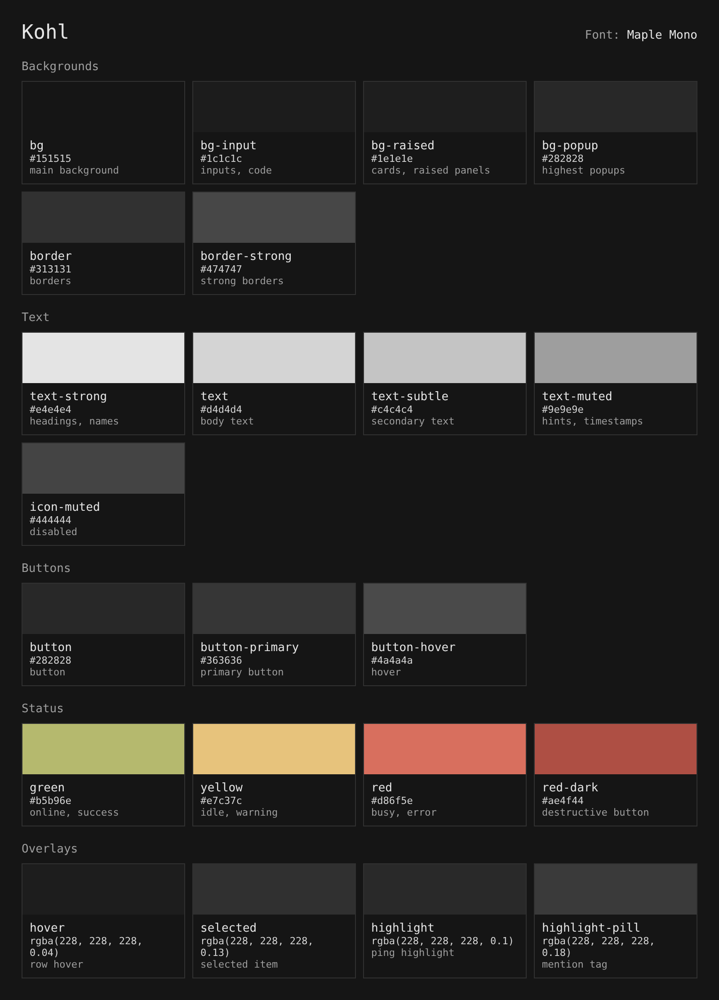

# KohlSharp

A soft black and white Discord theme for Vencord with sharp corners, by **MJdev**.

Version 1.2.0

## Features

- Sharp corners throughout
- Square profile pictures, with the circle behind them removed
- Soft white highlight and white side bar on messages that ping you
- Monochrome buttons, links (underlined) and syntax highlighting

## Requirements

- Discord with [Vencord](https://vencord.dev) installed
- Discord set to **Dark** mode (Settings → Appearance)
- An internet connection for the font, which loads from `cdn.jsdelivr.net`

The theme headers also list BetterDiscord as compatible.

## Install

1. Download `KohlSharp.theme.css`.
2. In Discord, open **Settings → Vencord → Themes → Local Themes**.
3. Click **Open Themes Folder** and move the file there.
4. Click **Load missing Themes**.
5. Enable the theme.

**Updating:** replace the old file in the themes folder, then press `Ctrl+R`.

## Customising

Open the theme file in any text editor.

**Ping highlight strength:** find `Soft white highlight` near the bottom of the file. Change the last number in `rgba(228, 228, 228, 0.1)`. A higher number is brighter. The rule below it, with `0.13`, controls the hover state.

**Font:** replace the `@import` lines at the top, then replace every `'Maple Mono'` with your font's name.

## Troubleshooting

| Problem | Try this |
|---|---|
| Colours don't apply | Check that Discord is in Dark mode and the theme is enabled |
| Font looks different | Check Vencord's Themes page for a blocked-resource notice and allow `cdn.jsdelivr.net` |
| Two styles seem mixed | Disable all other themes |
| Something looks broken after a Discord update | Discord may have renamed parts of its interface, so the theme needs an update |
